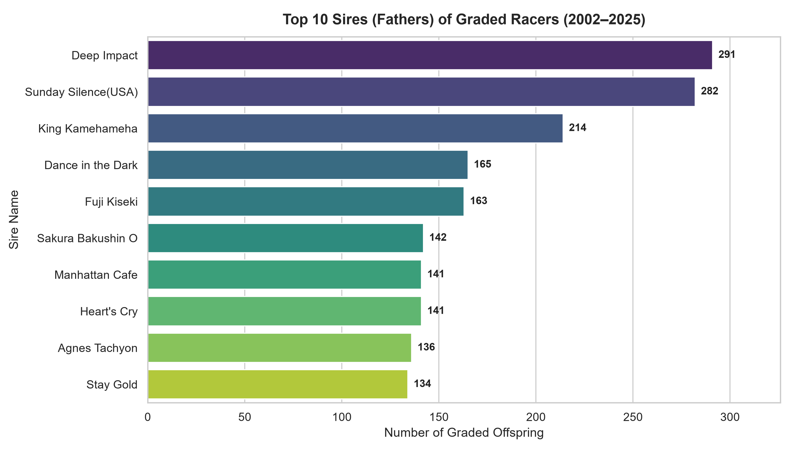
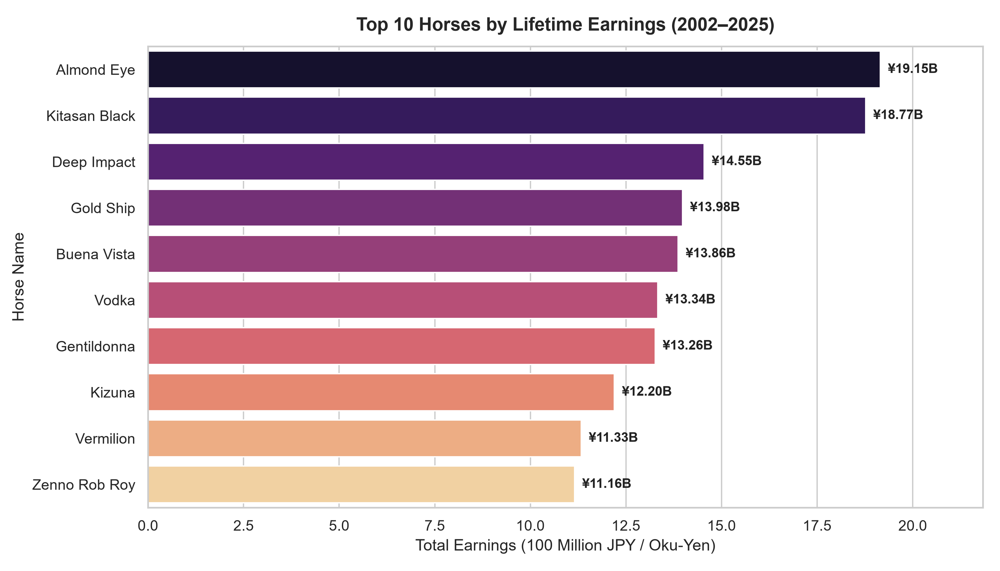
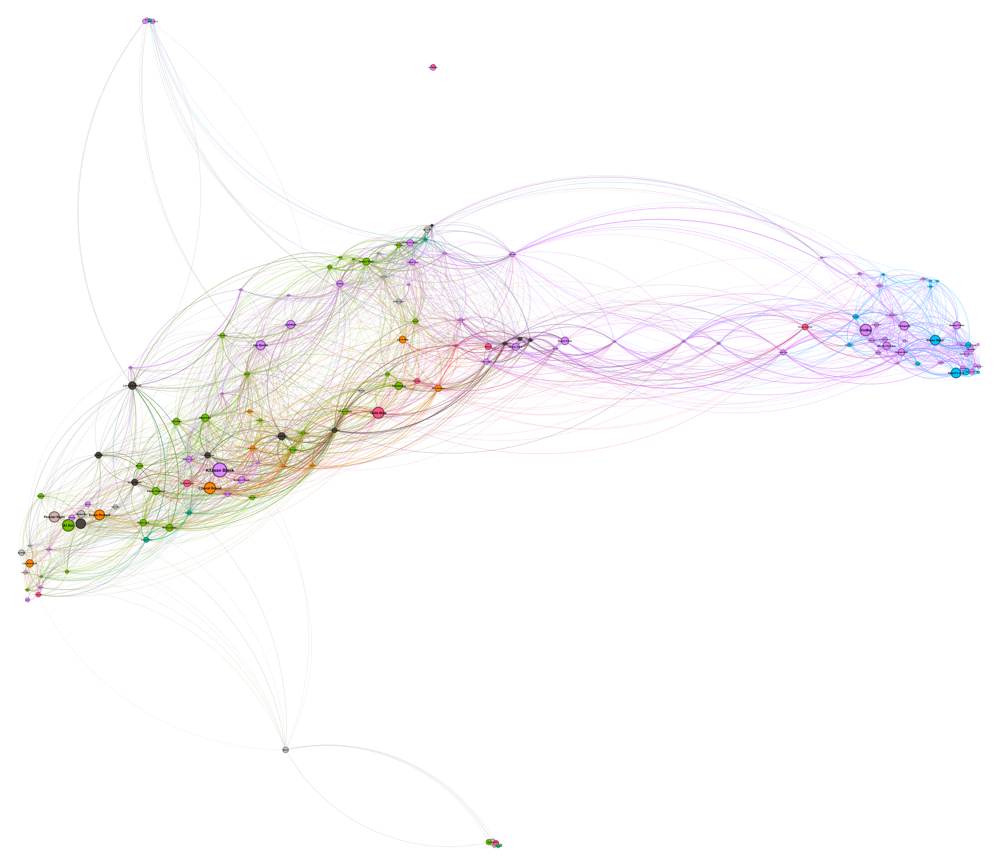
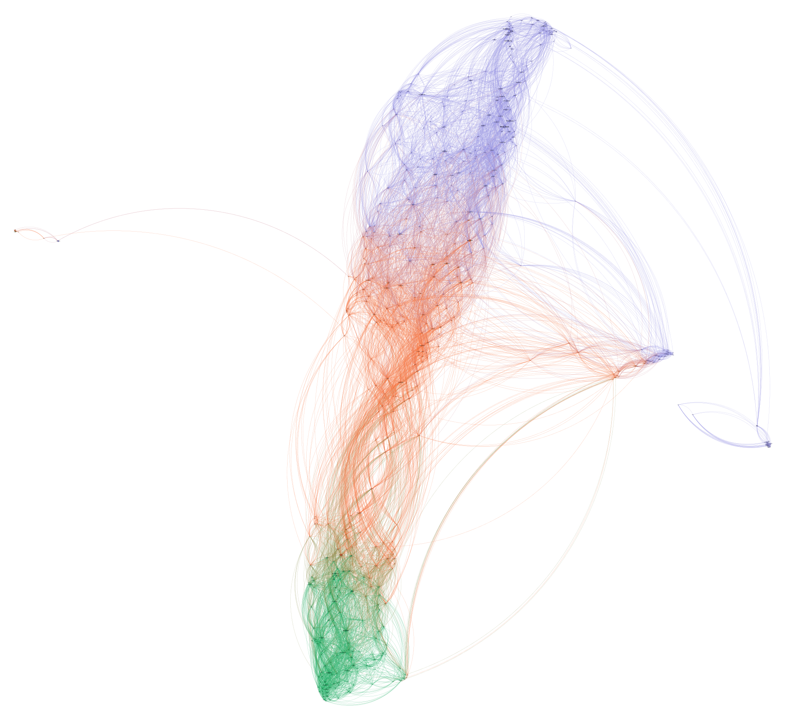
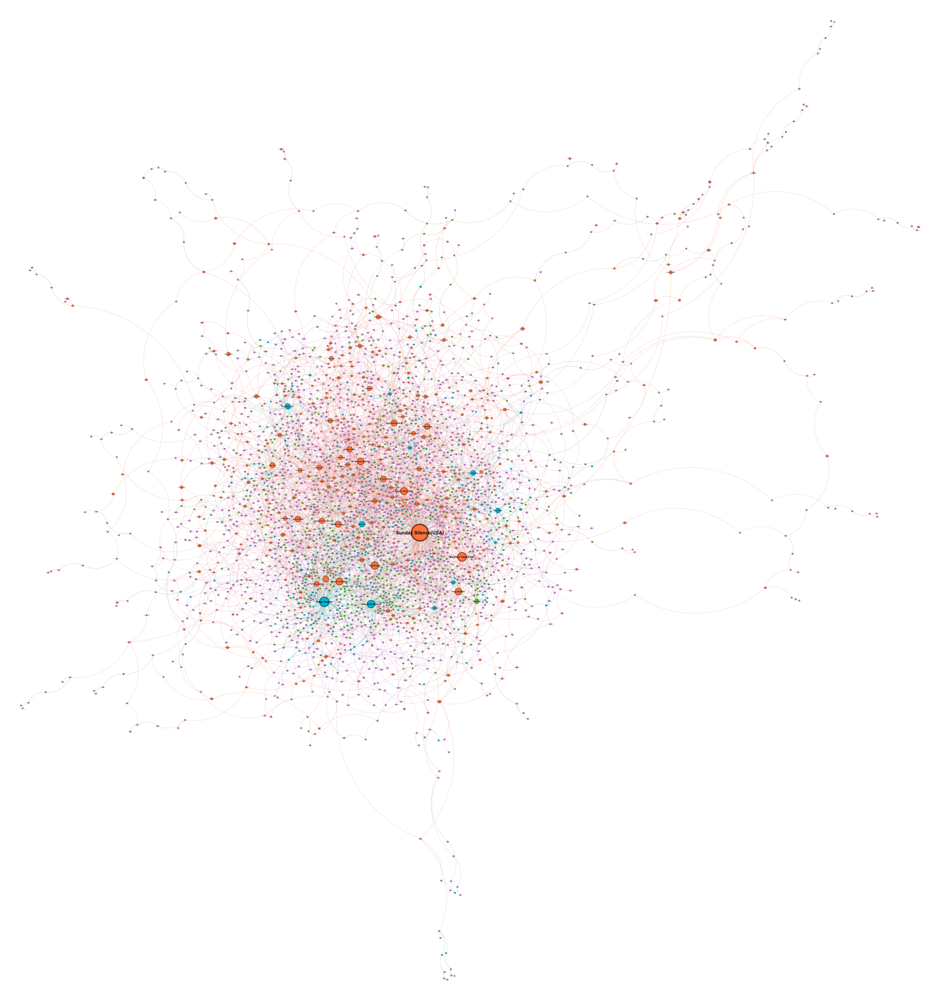
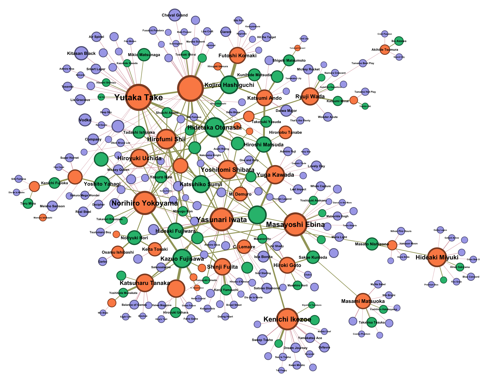
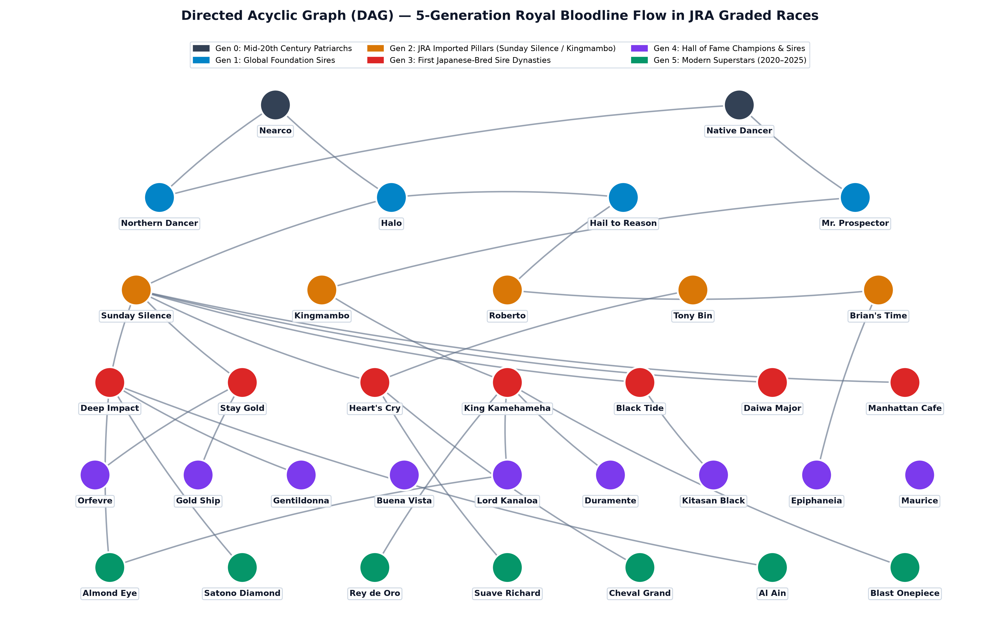
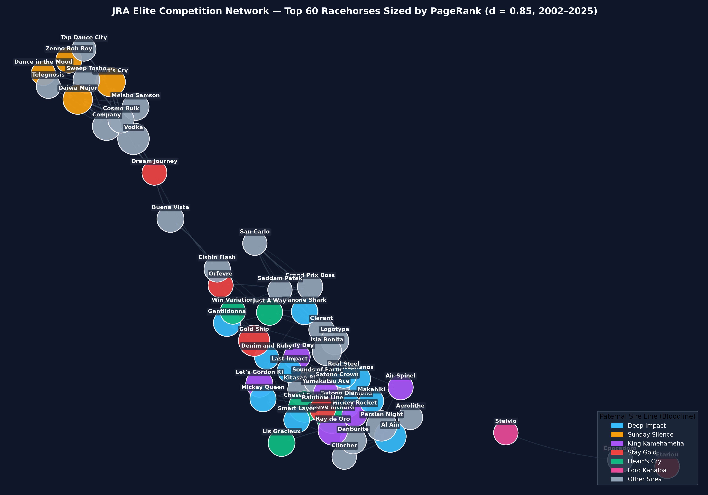
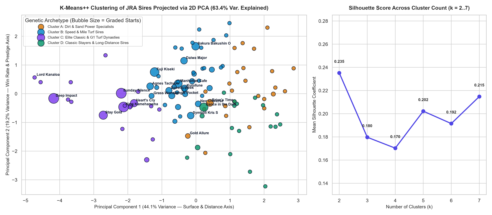
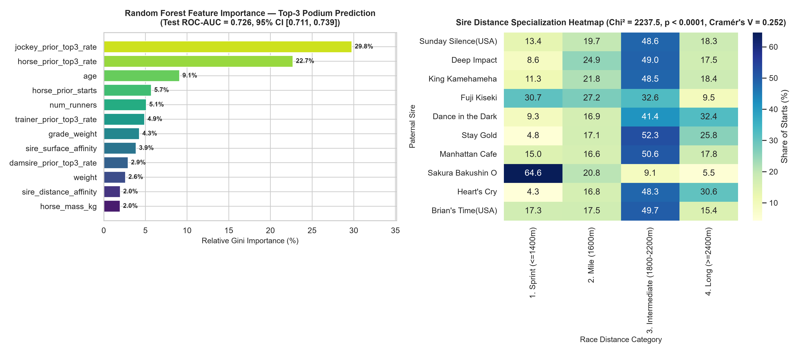

<div align="center">

# 🏇 JRA Graded Races & JBIS 5-Gen Pedigree Analytics
### *Engenharia de Dados, Tradução Semântica Híbrida via IA e Teoria dos Grafos no Turfe Japonês (2002–2025)*

<p align="center">
  <a href="README.md"></a>
  <a href="README.en.md"></a>
  <a href="README.ja.md"></a>
</p>

<p align="center">
  
  
  
  
  
  <a href="https://github.com/ImArthz/AEDS2_jra_analysis/actions/workflows/compile_latex.yml">
    
  </a>
</p>

</div>

---

## 📌 Visão Geral

Este repositório consolida o ecossistema de **Engenharia de Dados, Ciência dos Dados e Algoritmos em Grafos** desenvolvido no **CEFET-MG (Campus Divinópolis)** para as disciplinas integradas de **Algoritmos e Estruturas de Dados 2 (AEDS 2)** e **Ciência dos Dados**.

O sistema extrai, higieniza, traduz e modela **24 anos de histórico oficial (2002–2025)** das corridas de elite (**G1, G2 e G3**) da **Japan Racing Association (JRA)**, cruzando cada competidor com seu perfil biológico e sua **Árvore Genealógica de 5 Gerações** extraída do **Japan Bloodhorse Information System (JBIS)**. Todo o conjunto de dados está disponível de forma espelhada em **Japonês original (`data/csv/`)** e **100% traduzido e padronizado em Inglês (`data/csv_en/`)**.

---

## 📊 Números Consolidados do Dataset (Pós-Sanitização)

| Dimensão / Métrica | Volume Consolidado | Status de Qualidade (QA) |
| :--- | :---: | :--- |
| **Corridas Graded (`races` — G1, G2, G3)** | **3.216** provas (2002–2025) | `100%` preenchidas (Grade, Pista e Distância) |
| **Participações Esportivas (`race_entries`)** | **33.409** entradas | `100%` alinhadas (Jóquei, Treinador, Idade e Peso) |
| **Cavalos de Elite Únicos (`horses`)** | **8.209** atletas | Perfil biológico, pelagem e prêmios em Ienes (¥) |
| **Pedigree Direto (`pedigree`)** | **8.202** registros (`99,3%`) | *Sire*, *Dam*, *Grandsire* e *Dam Sire* |
| **Árvore Genealógica 5-Gen (`pedigree_tree`)** | **504.074** nós ancestrais | Até $2^1 + \dots + 2^5 = 62$ ancestrais por cavalo |
| **Dicionário Semântico IA (`gemini_cache.json`)** | **29.159** nomes próprios | `0` caracteres japoneses residuais na base EN |
| **Validação de Integridade Relacional** | **5 Tabelas 3NF** | **0 Erros, 0 Avisos (`✅ APROVADO`)** |

---

## 🏗 Arquitetura do Pipeline em 6 Etapas

```
[1. JRA Scraper] ──► [2. JBIS 5-Gen Scraper] ──► [3. Data Cleaning & Realignment]
      (HTML4/5)          (DFS 62 Ancestrais)         (25k linhas realinhadas)
                                                               │
[6. Grafos & ML] ◄── [5. QA Validator (0 Erros)] ◄── [4. Hybrid AI Translator]
 (DAG/PageRank)        (Integridade Referencial)     (Gemini Pool + Léxico JRA)
```

1. **[`src/scraper_jra.py`](src/scraper_jra.py) — Extração Histórica JRA (G1, G2, G3):**
   Minera resultados oficiais de 2002 a 2025 contornando mudanças drásticas de layout HTML ao longo das décadas, com *Skip Logic* em $O(1)$ e *Exponential Backoff*.
2. **[`src/scraper_pedigree.py`](src/scraper_pedigree.py) — Extração Biológica e Genealogia 5 Gerações (JBIS):**
   Navega pelas listas semânticas `<dt>/<dd>` do JBIS para capturar ganhos vitalícios (convertidos de *Man-Yen* $\times 10.000$), pelagem, criador e proprietário, construindo a árvore ascendente de 5 gerações via **Busca em Profundidade (DFS)** e mesclando automaticamente aliases ortográficos sob o mesmo ID biológico de 10 dígitos (`ON UPDATE CASCADE`).
3. **[`src/clean_data.py`](src/clean_data.py) — Sanitização Estrutural e Realinhamento Vetorial:**
   Corrige deslocamentos históricos de colunas da JRA (2004–2018) onde a fusão de Sexo+Idade (`性齢`) deslocava Jóquei, Tempo e Treinador; expurga ruídos de tabelas de apostas e imputa 100% de `grade`, `surface` (*Turf*, *Dirt*, *Obstacle*) e `distance` via normalização Unicode NFKC.
4. **[`hybrid_translator.py`](hybrid_translator.py) & [`src/translate_db.py`](src/translate_db.py) — Motor Híbrido de Tradução IA (JP $\to$ EN):**
   Combina dicionários estáticos $O(1)$ com um pool multi-modelo da API **Google Gemini** (`gemini-3.5-flash-lite`, `gemini-3.5-flash`, `gemini-3.7-flash`), processamento paralelo em lote e regras de *Kanmei* (prefixos tradicionais da JRA), resolvendo leituras *Nanori* de jóqueis (`武豊` $\to$ *Yutaka Take*) e grafias internacionais oficiais de cavalos (`ディープインパクト` $\to$ *Deep Impact*, `オルフェーヴル` $\to$ *Orfevre*).
5. **[`src/validate_data.py`](src/validate_data.py) — Auditoria Automática de Qualidade (QA):**
   Verifica chaves estrangeiras, cobertura de atributos, distribuição temporal Ano $\times$ Grade e ausência de órfãos ou duplicatas.
6. **[`src/graph_analysis.py`](src/graph_analysis.py) — Motor de Teoria dos Grafos (AEDS 2):**
   - **`PedigreeDAG` (Grafo Direcionado Acíclico):** Travessias em largura (BFS por geração) e profundidade (DFS), **LCA (*Lowest Common Ancestor*)** e cálculo do **Coeficiente de Endocruzamento (*Inbreeding*)**.
   - **`CompetitionGraph` (Rede de Rivalidade Ponderada):** Arestas ponderadas pelo nível da prova ($\text{G1}=1.0, \text{G2}=0.7, \text{G3}=0.5$), cálculo de **PageRank Esportivo**, **Centralidade de Grau**, **Caminho Mínimo de Dijkstra** e **Componentes Conexos**.
   - **`JockeyHorseGraph` & `JockeyTrainerGraph`:** Redes bipartidas de sinergia entre jóqueis, cavalos e treinadores.

---

## 📄 Relatórios Técnicos em LaTeX (Compilação Automática via CI/CD)

Documentação arquitetural e matemática completa (incluindo o estudo detalhado dos **7 Problemas de Tradução Semântica e Sanitização Estrutural**) compilada automaticamente para PDF via **GitHub Actions** a cada push:

<div align="center">
<table>
  <tr>
    <td align="center">
      <a href="https://github.com/ImArthz/AEDS2_jra_analysis/releases/latest/download/relatorio_extracao.pdf">
        
      </a>
    </td>
    <td align="center">
      <a href="https://github.com/ImArthz/AEDS2_jra_analysis/releases/latest/download/relatorio_extracao_en.pdf">
        
      </a>
    </td>
    <td align="center">
      <a href="https://github.com/ImArthz/AEDS2_jra_analysis/releases/latest/download/relatorio_extracao_ja.pdf">
        
      </a>
    </td>
  </tr>
</table>
</div>

- Código-fonte dos artigos: [`docs/relatorio_extracao.tex`](docs/relatorio_extracao.tex) | [`docs/relatorio_extracao_en.tex`](docs/relatorio_extracao_en.tex) | [`docs/relatorio_extracao_ja.tex`](docs/relatorio_extracao_ja.tex) | [`docs/proposta_ciencia_dos_dados.tex`](docs/proposta_ciencia_dos_dados.tex)

---

## 📈 Insights Visuais do Dataset (2002–2025)

### 🏆 Top 10 Garanhões (*Sires*) por Prole em Corridas Graded
As linhagens paternas mais dominantes da era moderna do turfe japonês, lideradas por **Deep Impact** (287 filhos em provas Graded) e seu pai **Sunday Silence (USA)** (281):

<p align="center">
  
</p>

### 💰 Top 10 Cavalos por Premiação Acumulada na Carreira
Os maiores ganhadores financeiros registrados no banco de dados (em centenas de milhões de Ienes — *Oku-Yen*), liderados por **Almond Eye** (¥19.15B) e **Kitasan Black** (¥18.77B):

<p align="center">
  
</p>

### 🕸️ Modelagem em Grafos no Gephi (Clique nas imagens para abrir o PDF Vetorial com Zoom Infinito!)
Redes complexas modeladas e exportadas via **Gephi** (`data/gephi/*.gexf` e `*.pdf`). **Dica:** *Clique sobre qualquer grafo abaixo para abrir o arquivo `.pdf` vetorial original e dar zoom de até 1600% nos nomes dos cavalos!*

<div align="center">
<table>
  <tr>
    <td align="center" width="50%">
      <b>1. Rede de Competição — Top 150 PageRank (por Linhagem)</b><br>
      <a href="data/gephi/competition_network_top150.pdf">
        
      </a>
    </td>
    <td align="center" width="50%">
      <b>2. Fluxo Temporal de Rivalidades — Top 500 (por Era 2002–2025)</b><br>
      <a href="data/gephi/competition_network_top500.pdf">
        
      </a>
    </td>
  </tr>
  <tr>
    <td align="center" width="50%">
      <b>3. Galáxia Genealógica — DAG 5 Gerações (4.475 Nós)</b><br>
      <a href="data/gephi/lineage_dag_elite.pdf">
        
      </a>
    </td>
    <td align="center" width="50%">
      <b>4. Rede Tripartida — Jóqueis ↔ Cavalos ↔ Treinadores</b><br>
      <a href="data/gephi/jockey_horse_trainer_network.pdf">
        
      </a>
    </td>
  </tr>
</table>
</div>

### 📊 Diagrama Hierárquico das Dinastias Reais (5 Gerações) & Subgrafo PageRank
<p align="center">
  
</p>
<p align="center">
  
</p>

### 3. Machine Learning & Testes de Hipóteses Estatísticos (`src/ml_analysis.py`)
Modelagem estatística inferencial e aprendizado de máquina sem vazamento temporal (*Zero Data Leakage*):
- **Especialização Genética Comprovada ($H_1$):**
  - **Sire $\times$ Superfície (Turf vs. Dirt):** $\chi^2 = 739.99$, $gl = 14$, $p = 2.43 \times 10^{-107}$, $V \text{ de Cramér} = 0.2514$.
  - **Sire $\times$ Categoria de Distância:** $\chi^2 = 2237.47$, $gl = 42$, $p = 3.71 \times 10^{-317}$, $V \text{ de Cramér} = 0.2523$.
  - **ANOVA & Kruskal-Wallis (Distância de Vitória por Sire):** $F(14, 930) = 16.46$ ($\eta^2 = 0.1986$, $p = 1.68 \times 10^{-35}$) e $H = 192.40$ ($p = 2.02 \times 10^{-29}$).
- **Validação Empírica do PageRank Esportivo ($H_2$, $N = 8.135$ cavalos):** Forte correlação com pódios Graded ($r = 0.8799$, $\rho = 0.7597$) e premiação acumulada ($r = 0.6266$), identificando **"Diamantes Injustiçados"** com zero vitórias Graded mas pódios contra lendas de G1 (*Sounds of Earth* #32, *Etariou* #43).
- **Clusterização Não-Supervisionada (K-Means++ & PCA 2D — 63,4% de Variância Explicada):** Segmentação automática de 106 garanhões em 4 arquétipos zootécnicos (*Dirt & Sand Specialists*, *Speed & Mile Turf Sires*, *Elite Classic & G1 Turf Dynasties* e *Classic Stayers*).
- **Classificação Supervisionada Cronológica (Treino: 2002–2013 | Validação: 2014–2015 | Teste Out-of-Time: 2016–2018, $N_{\text{teste}} = 5.889$):**

| Modelo Supervisionado (Predição de Pódio Top-3) | ROC-AUC (Teste 2016–2018) | IC 95% Bootstrap | PR-AUC | F1-Score | Acurácia |
| :--- | :---: | :---: | :---: | :---: | :---: |
| **Baseline Ingênuo (Prior Estratificado)** | `0.5000` | — | `0.2089` | `0.0000` | `0.7911` |
| **Regressão Logística L2 (Cost-Sensitive)** | `0.7144` | `[0.6992, 0.7275]` | `0.4257` | `0.4413` | `0.6762` |
| **Random Forest Classifier (CART Ensemble)** | **`0.7260`** | **`[0.7109, 0.7389]`** | **`0.4187`** | **`0.4585`** | **`0.6908`** |

<p align="center">
  
</p>
<p align="center">
  
</p>

---

## 🗂 Estrutura do Repositório

```text
AEDS2_jra_analysis/
├── .github/workflows/
│   └── compile_latex.yml         # CI/CD: Compila os relatórios LaTeX (XeLaTeX) e publica Releases
├── data/
│   ├── analysis/                 # Tabelas analíticas de PageRank, Inbreeding, K-Means PCA e Random Forest
│   ├── csv/                      # CSVs limpos no idioma original (Japonês)
│   ├── csv_en/                   # CSVs 100% traduzidos e padronizados em Inglês (Padrão Zenodo)
│   ├── gephi/                    # 4 Grafos .gexf + 4 Grafos Vetoriais .pdf renderizados no Gephi
│   ├── sqlite/                   # Bancos relacionais SQLite3 (jra_graded.db & jra_graded_en.db)
│   └── gemini_cache.json         # Dicionário semântico com 29.159 termos traduzidos via IA
├── docs/
│   ├── assets/                   # Visualizações de alta resolução (EN, JA, Gephi e ML)
│   ├── proposta_ciencia_dos_dados.tex
│   ├── relatorio_extracao.tex    # Relatório Técnico Completo (PT-BR)
│   ├── relatorio_extracao_en.tex # Relatório Técnico Completo (EN)
│   └── relatorio_extracao_ja.tex # Relatório Técnico Completo (JA)
├── src/
│   ├── database.py               # Schema SQLite 3NF, índices e exportador CSV
│   ├── scraper_jra.py            # Web Scraper JRA (G1, G2, G3)
│   ├── scraper_pedigree.py       # Web Scraper JBIS (Perfil + Pedigree 5 Gerações)
│   ├── clean_data.py             # Sanitização estrutural, realinhamento e imputação
│   ├── validate_data.py          # Sistema de QA e integridade referencial
│   ├── translate_db.py           # Construtor do banco e CSVs em Inglês
│   ├── graph_analysis.py         # Grafos (DAG, LCA, Inbreeding F_X, PageRank, Dijkstra, Bipartidos)
│   ├── export_gephi.py           # Exportador de redes .gexf e tabelas analíticas de grafos
│   ├── ml_analysis.py            # Testes de Hipóteses (Chi2, ANOVA, Kruskal), K-Means PCA e Random Forest
│   └── run_pipeline.py           # Orquestrador CLI completo
├── zenodo/
│   ├── .zenodo.json              # Metadados oficiais de depósito científico (DataCite / OpenAIRE)
│   └── GEPHI_AND_ZENODO_GUIDE.md # Guia passo a passo de estilização no Gephi e publicação no Zenodo
├── hybrid_translator.py          # Motor Híbrido de Tradução (Gemini Multi-Model Pool + Batch)
├── generate_plots.py             # Gerador dos gráficos analíticos (EN e JA)
└── LICENSE                       # Licença MIT
```

---

## 🚀 Como Executar

```bash
# 1. Validar a integridade do banco de dados (QA)
python src/validate_data.py

# 2. Executar limpeza estrutural e regenerar o banco/CSVs em Inglês
python src/clean_data.py
python src/translate_db.py

# 3. Executar a análise de Grafos (DAG 5-Gen, Competição, PageRank, Parcerias e Gephi .gexf)
python src/graph_analysis.py
python src/export_gephi.py

# 4. Executar Testes de Hipóteses Estatísticos, K-Means PCA e Random Forest
python src/ml_analysis.py

# 5. Executar o pipeline completo via CLI
python src/run_pipeline.py --start-year 2002 --end-year 2025 --analyze
```

---

<div align="center">
  <sub>Desenvolvido por <b>Arthur De Oliveira Mendonça</b> — CEFET-MG (Campus Divinópolis) • Disciplinas de AEDS 2 & Ciência dos Dados</sub>
</div>
