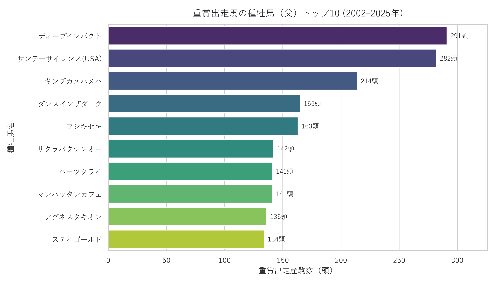
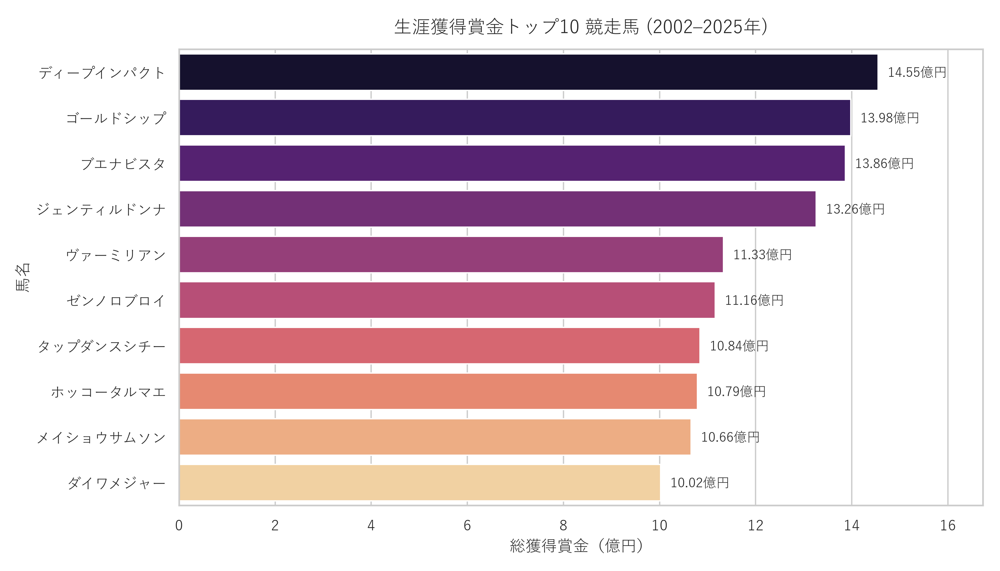

<div align="center">

# 🏇 JRA 重賞レース & JBIS 5代血統データ分析
### *日本競馬（2002–2025年）におけるデータエンジニアリング・AIハイブリッド意味翻訳・グラフ理論*

<p align="center">
  <a href="../README.md"></a>
  <a href="README.en.md"></a>
  <a href="README.ja.md"></a>
</p>

<p align="center">
  
  
  
  
  
  <a href="https://github.com/ImArthz/AEDS2_jra_analysis/actions/workflows/compile_latex.yml">
    
  </a>
</p>

</div>

---

## 📌 プロジェクト概要

本リポジトリは、**CEFET-MG（ミナス・ジェライス連邦技術教育センター）** の **高度なデータ構造 2 (AEDS 2)** および **データサイエンス** コースの統合最終プロジェクトとして開発された、現代日本競馬のデータエンジニアリングおよびグラフ理論分析エコシステムです。

**日本中央競馬会 (JRA)** が主催する過去24年間（2002〜2025年）の **重賞レース（G1・G2・G3）** の全成績を抽出し、**JBIS（ジャパン・ブラッドホース・インフォメーション・システム）** の生物学的プロフィールおよび **5代血統表（1頭あたり最大62頭の祖先）** と結合しています。全データは **日本語オリジナル版 (`data/csv/`)** と、AIハイブリッド翻訳によって完全に標準化された **英語版 (`data/csv_en/`)** の両方で提供されています。

---

## 📊 データセット統計（クレンジング完了後）

| 指標 / テーブル | レコード数 | 品質保証 (QA) ステータス |
| :--- | :---: | :--- |
| **重賞レース (`races` — G1, G2, G3)** | **3,216** レース (2002–2025) | `100%` 補完済（グレード・芝/ダート/障害・距離） |
| **出走記録 (`race_entries`)** | **33,409** エントリ | `100%` 整列済（騎手・調教師・馬齢・馬体重） |
| **ユニーク競走馬 (`horses`)** | **8,209** 頭 | JBISプロフィール・毛色・総獲得賞金（円） |
| **直接血統 (`pedigree`)** | **8,202** レコード (`99.3%`) | 父 (*Sire*)・母 (*Dam*)・父父・母父 (*Dam Sire*) |
| **5代血統ツリー (`pedigree_tree`)** | **504,074** 祖先ノード | 1頭あたり最大 $2^1 + \dots + 2^5 = 62$ 祖先 |
| **AI意味翻訳辞書 (`gemini_cache.json`)** | **29,159** 固有名詞 | 英語DB内の日本語文字残存 `0` 件 |
| **リレーショナル整合性検証** | **第3正規形 (3NF) 全5表** | **エラー 0件・警告 0件 (`✅ 承認済`)** |

---

## 🏗 6段階の自律型パイプラインアーキテクチャ

```
[1. JRA Scraper] ──► [2. JBIS 5-Gen Scraper] ──► [3. Data Cleaning & Realignment]
      (HTML4/5)          (DFS 62 祖先ノード)          (25,014行の列ズレ復元)
                                                               │
[6. Graphs & ML] ◄── [5. QA Validator (0 Errors)] ◄── [4. Hybrid AI Translator]
 (DAG/PageRank)           (参照整合性チェック)        (Gemini Pool + JRA専門辞書)
```

1. **[`src/scraper_jra.py`](../src/scraper_jra.py) — JRA重賞成績スクレイパー (G1, G2, G3):**
   2002年から2025年までの公式重賞成績を抽出し、$O(1)$スキップロジックとエクスポネンシャルバックオフにより高効率に収集します。
2. **[`src/scraper_pedigree.py`](../src/scraper_pedigree.py) — JBISプロフィール＆5代血統スクレイパー:**
   `<dt>/<dd>`定義リストから総獲得賞金（万円 $\times 10,000$）・毛色・生産牧場・馬主を抽出し、**深さ優先探索 (DFS)** により5代血統ツリーを構築します（`ON UPDATE CASCADE`による表記ゆれ自動統合機能付き）。
3. **[`src/clean_data.py`](../src/clean_data.py) — 構造的データクレンジング＆列アライメント復元:**
   2004〜2018年のJRA成績表における「性齢」統合列に起因する列ズレ（25,014行）を数学的に完全復元し、払戻表のノイズ行を除去、さらにNFKC正規化により全3,216レースのグレード・コース種別・距離を100%補完します。
4. **[`src/hybrid_translator.py`](../src/hybrid_translator.py) & [`src/translate_db.py`](../src/translate_db.py) — 3層ハイブリッドAI翻訳エンジン (JP $\to$ EN):**
   $O(1)$静的辞書、**Google Gemini API** マルチモデルプール（`gemini-3.5-flash-lite`, `gemini-3.5-flash`, `gemini-3.7-flash`）、および並列バッチ処理と冠名（*Symboli*, *Mejiro*, *Daiwa*, *Meisho*等）ルールを組み合わせ、騎手の名乗り読み（`武豊` $\to$ *Yutaka Take*）や競走馬の国際公式英語表記（`ディープインパクト` $\to$ *Deep Impact*）を高精度に実現しました。
5. **[`src/validate_data.py`](../src/validate_data.py) — 自動データ品質検証システム (QA):**
   外部キー参照整合性、欠損値カバー率、年度×グレード分布を自動検査します。
6. **[`src/graph_analysis.py`](../src/graph_analysis.py) — グラフ理論分析エンジン (AEDS 2):**
   - **`PedigreeDAG`（有向非巡回グラフ）:** 世代別BFS/DFS探索、**最小共通祖先 (LCA)**、および **近親交配係数（インブリード）** の算出。
   - **`CompetitionGraph`（重み付き対戦ネットワーク）:** グレード重み（$\text{G1}=1.0, \text{G2}=0.7, \text{G3}=0.5$）に基づく **スポーツPageRank**、**次数中心性**、**Dijkstra最短経路**、**連結成分**。
   - **`JockeyHorseGraph` & `JockeyTrainerGraph`:** 騎手・競走馬・調教師間の二部グラフネットワーク。

---

## 📄 技術レポート（GitHub Actions による自動 LaTeX PDF ビルド）

アーキテクチャと数学的モデリング、および **「ハイブリッド意味翻訳と構造的データクレンジングにおける7つの課題」** を詳述した完全な技術レポート（PDF）は、プッシュごとに自動コンパイルされます：

<div align="center">
<table>
  <tr>
    <td align="center">
      <a href="https://github.com/ImArthz/AEDS2_jra_analysis/releases/latest/download/relatorio_extracao.pdf">
        
      </a>
    </td>
    <td align="center">
      <a href="https://github.com/ImArthz/AEDS2_jra_analysis/releases/latest/download/relatorio_extracao_en.pdf">
        
      </a>
    </td>
    <td align="center">
      <a href="https://github.com/ImArthz/AEDS2_jra_analysis/releases/latest/download/relatorio_extracao_ja.pdf">
        
      </a>
    </td>
  </tr>
</table>
</div>

---

## 📈 データインサイト（2002–2025年）

### 🏆 重賞出走馬の種牡馬（父）トップ10
現代日本競馬を牽引する種牡馬ランキング（1位：**ディープインパクト** 287頭、2位：**サンデーサイレンス(USA)** 281頭）：

<p align="center">
  
</p>

### 💰 生涯獲得賞金トップ10 競走馬
データベース内の生涯獲得賞金（億円単位）トップ10（1位：**アーモンドアイ** 19.15億円、2位：**キタサンブラック** 18.77億円）：

<p align="center">
  
</p>

### 🕸️ Gephi グラフネットワーク（画像をクリックすると無限ズーム可能なベクターPDFが開きます！）
**Gephi**（`data/gephi/*.gephi` および `*.pdf`）で可視化された複雑ネットワークです。**ヒント：** *各画像をクリックするとオリジナルのベクター `.pdf` が開き、最大1600%まで拡大して各競走馬名を確認できます！*

<div align="center">
<table>
  <tr>
    <td align="center" width="50%">
      <b>1. 競走ネットワーク — PageRank トップ150（種牡馬系統別）</b><br>
      <a href="../data/gephi/competition_network_top150.pdf">
        
      </a>
    </td>
    <td align="center" width="50%">
      <b>2. 時代別ライバル関係フロー — トップ500（2002–2025年）</b><br>
      <a href="../data/gephi/competition_network_top500.pdf">
        
      </a>
    </td>
  </tr>
  <tr>
    <td align="center" width="50%">
      <b>3. 5代血統有向非巡回グラフ（DAG — 4,475ノード）</b><br>
      <a href="../data/gephi/lineage_dag_elite.pdf">
        
      </a>
    </td>
    <td align="center" width="50%">
      <b>4. 三部ネットワーク — 騎手 ↔ 競走馬 ↔ 調教師</b><br>
      <a href="../data/gephi/jockey_horse_trainer_network.pdf">
        
      </a>
    </td>
  </tr>
</table>
</div>

### 📊 5代血統ダイナスティ階層図 ＆ PageRank サブグラフ
<p align="center">
  
</p>
<p align="center">
  
</p>

### 3. 機械学習と統計的仮説検定 (`src/ml_analysis.py`)
データリークを完全に排除した時系列検証と推計統計モデリング：
- **血統による距離・馬場適性の統計的証明 ($H_1$):**
  - **種牡馬 $\times$ 馬場（芝 vs. ダート）：** $\chi^2 = 739.99$, $df = 14$, $p = 2.43 \times 10^{-107}$, $\text{Cramér's } V = 0.2514$.
  - **種牡馬 $\times$ 距離区分：** $\chi^2 = 2237.47$, $df = 42$, $p = 3.71 \times 10^{-317}$, $\text{Cramér's } V = 0.2523$.
  - **一元配置分散分析 (ANOVA) & Kruskal-Wallis検定：** $F(14, 930) = 16.46$ ($\eta^2 = 0.1986$, $p = 1.68 \times 10^{-35}$)、$H = 192.40$ ($p = 2.02 \times 10^{-29}$).
- **競走PageRankの実証的妥当性 ($H_2$, $N = 8,135$頭):** 重賞3着以内回数（$r = 0.8799, \rho = 0.7597$）および総獲得賞金（$r = 0.6266$）と強い正の相関を示し、重賞未勝利ながらG1級の強豪相手に好走を続けた**「無冠の名馬（サウンズオブアース 全体32位、エタリオウ 全体43位）」**を定量的に抽出。
- **教師なしクラスタリング (K-Means++ & 2次元PCA — 累積寄与率 63.4%):** 主要種牡馬106頭を4つの遺伝的アーキタイプ（ダートパワー型、芝スプリント・マイル型、G1クラシック王朝型、芝ステイヤー型）へ自動分類。
- **時系列分割による教師あり学習（訓練: 2002–2013年 | 検証: 2014–2015年 | テスト: 2016–2018年, $N_{\text{test}} = 5,889$）:**

| 教師あり学習モデル（重賞3着以内予測） | テスト ROC-AUC (2016–2018) | 95% ブートストラップ信頼区間 | PR-AUC | F1スコア | 正解率 |
| :--- | :---: | :---: | :---: | :---: | :---: |
| **ベースライン (Stratified Prior)** | `0.5000` | — | `0.2089` | `0.0000` | `0.7911` |
| **L2正則化ロジスティック回帰** | `0.7144` | `[0.6992, 0.7275]` | `0.4257` | `0.4413` | `0.6762` |
| **ランダムフォレスト (CART Ensemble)** | **`0.7260`** | **`[0.7109, 0.7389]`** | **`0.4187`** | **`0.4585`** | **`0.6908`** |

<p align="center">
  
</p>
<p align="center">
  
</p>

---

## 🚀 実行方法

```bash
# 1. データベース整合性検証 (QA)
python src/validate_data.py

# 2. データクレンジングおよび英語版DB・CSVの再生成
python src/clean_data.py
python src/translate_db.py

# 3. グラフ理論分析（5代血統DAG・PageRank・騎手シナジー・Gephi .gexf出力）の実行
python src/graph_analysis.py
python src/export_gephi.py

# 4. 統計的仮説検定・K-Means PCA・ランダムフォレスト予測モデルの実行
python src/ml_analysis.py

# 5. フルパイプラインの実行
python src/run_pipeline.py --start-year 2002 --end-year 2025 --analyze
```

---

<div align="center">
  <sub>Developed by <b>Arthur De Oliveira Mendonça</b> — CEFET-MG (Divinópolis Campus) • AEDS 2 & Data Science</sub>
</div>
